<div align="center">



<br/>

[](https://muhammadessa2002.github.io/My_PORTFOLIO/)
[](https://www.linkedin.com/in/m-essa/)
[](mailto:essabahootraza@gmail.com)
[](https://pypi.org/project/reyplot/)


</div>

---

## About

I am a Data Analyst and M.S. Data Science candidate based in Karachi, Pakistan. My background is in Physics, which shapes how I work: start from first principles, test assumptions, and communicate results clearly.

I build tools as well as analyses. I have published a plotting library to PyPI and built an interactive neural network visualizer from scratch, both with the goal of making data and models easier to understand.

| | |
|---|---|
| **Current** | M.S. Data Science (2025 - 2027), Mohammad Ali Jinnah University, Karachi |
| **Previous** | B.S. Physics (2020 - 2024), Federal Urdu University of Arts, Sciences & Technology |
| **Focus** | Data analysis, visualization, machine learning fundamentals, scientific software |
| **Coursework** | Machine Learning, Database Management Systems, Tools and Techniques for Data Science |

---

## Featured Projects

### Neural Canvas: MNIST Neural Network Visualizer

Draw a digit on a 28x28 board and watch activations flow through every layer of a neural network in real time. The forward pass is computed live in the browser from weights trained in Python, so what you see is the actual math, not an animation.

<p align="center">
  <a href="https://muhammadessa2002.github.io/neural_canvas/">
    
  </a>
</p>

<p align="center">
  <a href="https://muhammadessa2002.github.io/neural_canvas/"></a>
  <a href="https://github.com/MuhammadEssa2002/neural_canvas"></a>
</p>

| | Model 1 | Model 2 | Model 3 |
|---|---|---|---|
| **Digits** | Western (0-9) | Western (0-9) | Eastern Arabic-Indic (٠-٩) |
| **Architecture** | 784 → 20 → 20 → 10 | 784 → 40 → 40 → 10 | 784 → 20 → 20 → 15 → 10 |
| **Loss** | Mean Squared Error | Cross-Entropy | Cross-Entropy |
| **Trained with** | NumPy | NumPy | JAX |
| **Test accuracy** | 92% | 96% | 96% |

**Highlights**
- Three pre-trained networks, switchable instantly, including one for Eastern Arabic-Indic digits
- Fully client-side: p5.js for rendering, Math.js for matrix operations, no backend
- Open to contributions: anyone can train a model on their own script or dataset and add it to the visualizer

---

### ReyPlot: Lightweight 2D Scientific Plotting Library

A Python plotting library built from scratch and published on PyPI, designed for expressive visualization with minimal code.

- Layer-based architecture (inner and outer layers)
- Advanced styling: shadows, glow effects, gradients
- Export to PNG, JPG, and SVG

```bash
pip install reyplot
```

<p>
  <a href="https://github.com/MuhammadEssa2002/reyplot"></a>
  <a href="https://pypi.org/project/reyplot/"></a>
</p>

---

### Additional Work

- **Data Analytics Portfolio:** data cleaning, transformation, and visualization projects using Python (Pandas, Matplotlib) and SQL
- **Web Scraping and API Development:** custom scripts and APIs for extracting and serving data

More on my [portfolio](https://muhammadessa2002.github.io/My_PORTFOLIO/) and in my [repositories](https://github.com/MuhammadEssa2002?tab=repositories).

---

## Technical Skills

<table>
  <tr>
    <td><b>Languages</b></td>
    <td>
      
      
      
    </td>
  </tr>
  <tr>
    <td><b>Data and ML</b></td>
    <td>
      
      
      
    </td>
  </tr>
  <tr>
    <td><b>Visualization</b></td>
    <td>
      
      
      
    </td>
  </tr>
  <tr>
    <td><b>Databases</b></td>
    <td>
      
    </td>
  </tr>
  <tr>
    <td><b>Tools</b></td>
    <td>
      
      
    </td>
  </tr>
</table>

**Core capabilities:** data cleaning and transformation, statistical analysis, trend identification, relational database design, complex SQL queries, automation, library and API development.

---

## GitHub Activity

<p align="center">
  
  
</p>

---

<div align="center">

*From physics equations to data insights, solving problems one line of code at a time.*

</div>
